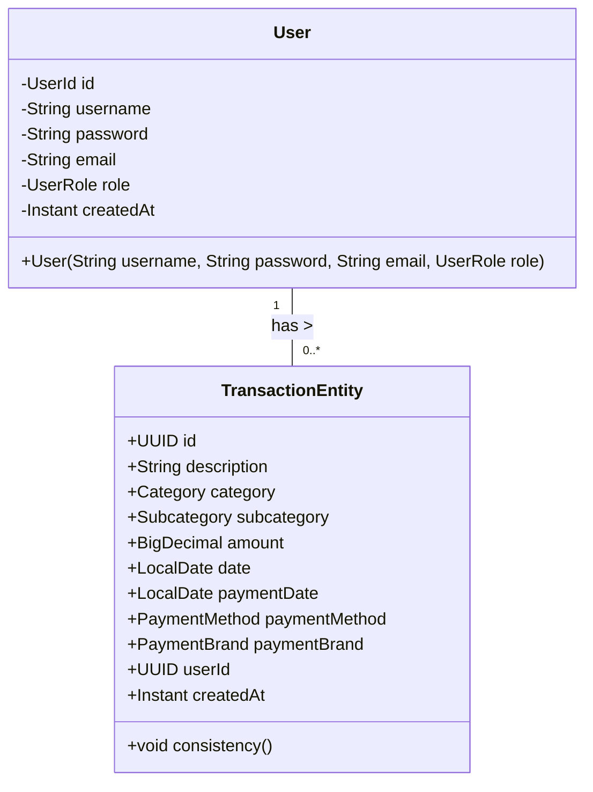
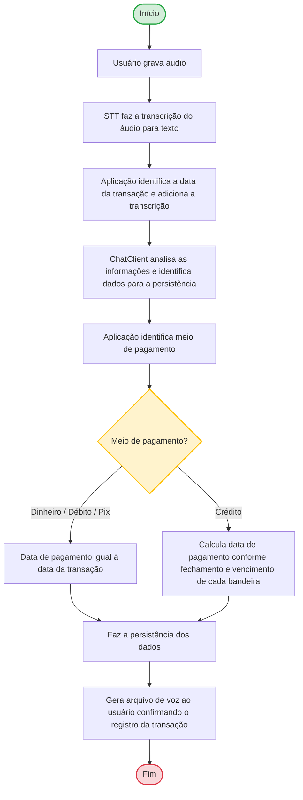

## Controle de orçamento pessoal utilizando IA
Desenvolvimento de aplicação (backend) para controle de orçamento pessoal, utilizando IA para caputurar mensagens de voz gravadas pelo usuário da aplicação via interface RestFull para analisar os dados transcritos, persistir em banco de dados, finalizando com uma mensagem ao usuário de confirmação da transação com informações sobre o registro.

## Diagrama de classes

## Fluxograma

## Linguagens utilizadas
- Java Versão 21
- Spring Boot 4.1.1

## Recursos Utilizados
- Spring Boot Web
- Spring Boot JPA
- Spring Boot Docker-Compose
- Spring Boot Validation
- Spring Boot Actuator
- Spring Boot Admin e Server
- Spring AI model OpenAI
- Spring Boot Security
- Liquibase
- MapStruct

## Referências

- [DIO - dio-spring-boot-learning-track
  /05-spring-ai](https://github.com/thpoiani/dio-spring-boot-learning-track/tree/main/05-spring-ai)

## Autores

- [@Anderson-G-Silva](https://github.com/Anderson-G-Silva)

